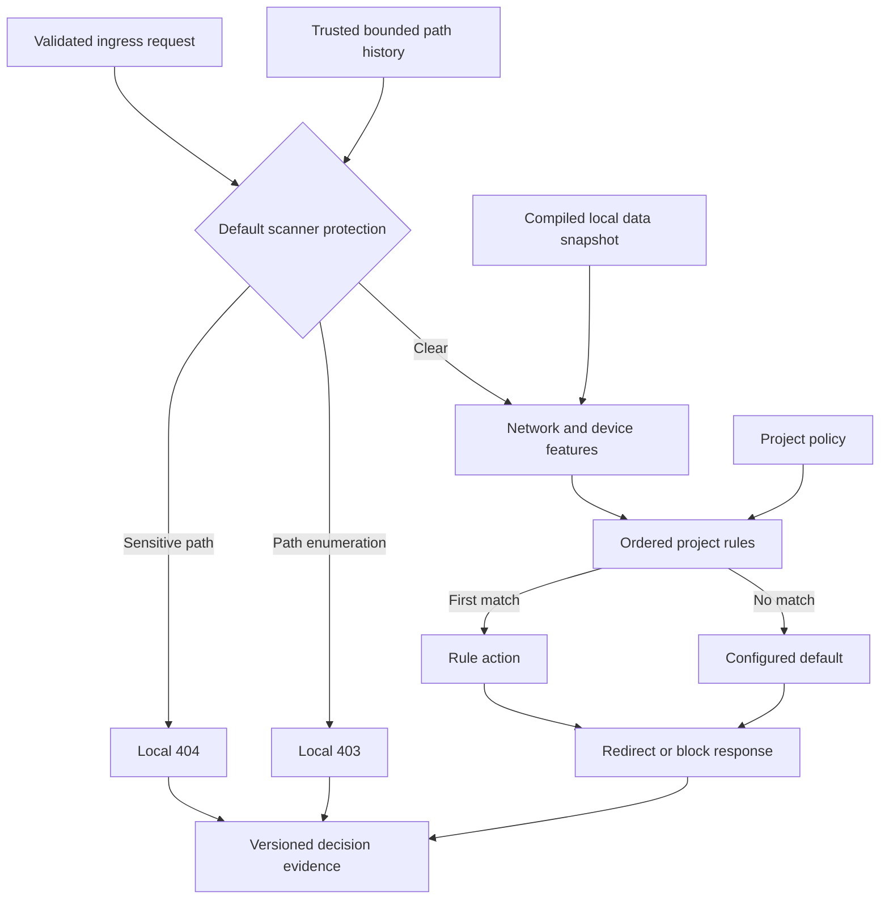
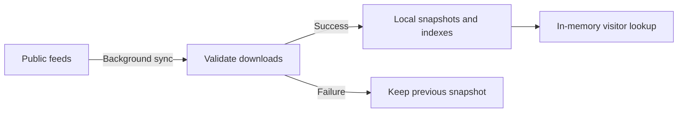

# Radixing Traffic Engine

[](https://github.com/imphillip/radixing-traffic-engine/actions/workflows/ci.yml)
[](LICENSE)

A deterministic **Traffic Distribution System (TDS)** for paid-traffic ingress, A/B destinations and conditional redirects. Open IP, network and crawler datasets supply local request features; explicit project rules select a destination. Scanner protection is included by default. Run the Node.js redirect service or embed the TypeScript decision core.

**Version 1.2.0 uses no Jev, LLM, model providers or API keys.** Identical policy, data snapshot, request observations and evaluation time produce identical decisions. Deterministic matching does not make upstream labels, User-Agent claims or inferred locations infallible.

## Use cases

| Scenario | Configuration |
| --- | --- |
| Advertising ingress | Select a destination using campaign parameters, geography, network, browser or device signals |
| A/B landing pages | Assign a stable key to weighted destinations with a fixed salt and an explicit missing-key fallback |
| Regional or device destinations | Apply ordered conditions and retain a default destination for unmatched requests |
| Scanner noise at ingress | Terminate sensitive-file probes and trusted path-enumeration evidence before business routing |

Developers researching **traffic cloaking** or **conditional delivery** can reuse the routing and feature adapters. The engine does not authenticate advertising-platform reviewers or infer visitor intent. It provides supporting scan protection and can sit behind a **WAF**, but is not a WAF ruleset or replacement. There is no bundled frontend UI, merchant control plane, origin proxy or conversion tracker.

## Request flow



The standalone service computes bounded path history automatically. Embedded hosts supply trusted enumeration evidence; the synchronous core has no hidden visitor history. Enabled scanner guards precede project rules, including catch-all redirects.

## Where feature data lives

**Datasets are downloaded into the deployment environment, not committed to this repository or queried upstream for each visitor.** Git and release packages contain adapter code, dependency declarations, documentation and examples. Bowser is installed as a pinned dependency; remote IP/network/crawler feeds become local operational snapshots.



| Event | Standalone default behavior |
| --- | --- |
| First start without data | Download and validate before accepting traffic |
| Normal traffic | Query local in-memory indexes; no dataset network call |
| Scheduled refresh | Fetch all configured feeds every 24 hours and atomically activate a valid snapshot |
| Failed refresh | Keep the preceding valid snapshot |
| Source older than seven days | Omit its facts as unknown; continue guards and project evaluation |
| External sync or rollback | Reload a changed snapshot within one minute |

Local files default to `.tds-data/`; use persistent storage across restarts. The embedded core does not download or schedule updates: its host supplies a snapshot and owns refresh/publication. See [deployment modes](docs/deployment.md) and [data sources](docs/data-sources.md).

## Included capabilities

- IPtoASN IPv4 and IPv6 ASN/organization mapping.
- X4B known VPN and datacenter IPv4 prefix lists.
- Automatically refreshed crawler User-Agent rules, matched with a linear-time RE2 engine.
- Browser, OS and device parsing with pinned Bowser; bounded Client Hints consistency checks.
- Optional DB-IP Country Lite geolocation with attribution requirements.
- Project rules for network, geography, device, browser, campaign, path and method; IPv4/IPv6 CIDR conditions.
- Stable weighted A/B assignment using an explicit key, fixed salt and missing-key fallback.
- Redirects with explicit query forwarding and optional path forwarding.
- Default sensitive-path blocking and bounded standalone path-enumeration protection before project routing.
- Checksummed data snapshots, atomic activation, previous-version rollback and source freshness evidence.
- A standalone Node.js service with scheduled refresh, a synchronous core, and a portable Web data builder for host-owned background jobs.

Network and bot labels never block traffic automatically. Sensitive exposure targets return 404. Enumeration returns 403 after 60 requests covering at least 40 paths within 15 seconds, followed by a fixed 60-second cooldown. See [scanner protection](docs/scanner-protection.md) for explicit overrides, tracking capacity, shared-IP limitations and host responsibilities. Browser Canvas/WebGL collection and distributed abuse prevention are outside this release.

## Run

Requires Node.js 22 or later.

```sh
git clone https://github.com/imphillip/radixing-traffic-engine.git
cd radixing-traffic-engine
git checkout v1.2.0
npm ci
npm run data:sync
npm start -- --policy examples/policy.json --data .tds-data
```

Edit the example policy to use your ingress hostname and HTTPS destinations. The example uses reserved `example.com` domains and is not a live routing configuration. The service binds to `127.0.0.1:8787` by default; use a TLS reverse proxy for public ingress.

```sh
curl -I -H 'Host: go.example.com' http://127.0.0.1:8787/
```

On startup the service loads a verified snapshot, or downloads one if no snapshot exists. It refreshes all configured sources every 24 hours and reloads externally updated or rolled-back snapshots every minute. Sources older than seven days are excluded from enrichment. Change these limits with `--refresh-hours` and `--max-age-hours`.

```sh
# Optional country lookup; read the attribution requirements first.
npm run data:sync -- --country
npm start -- --country

# Restore the previously active dataset; a running service reloads it within a minute.
node dist/cli.js rollback --data .tds-data
```

Country mode must be used consistently for sync and serve. With country mode, the current month's DB-IP URL is resolved on every refresh. Without it, country can be supplied by a trusted host integration.

## Embed

The package is distributed through GitHub and release assets, not the npm registry. Pin a tag or a full commit for production builds.

```sh
npm install git+https://github.com/imphillip/radixing-traffic-engine.git#v1.2.0
```

```ts
import { createTds } from "@radixing/traffic-engine";

const tds = createTds(projectPolicy, downloadedSnapshot);
const { response, decision } = tds.handle({
  request,
  ip: trustedClientIp,
  now: Date.now(),
});
// Return response; persist decision versions and rule IDs in your own audit store.
```

`@radixing/traffic-engine/node` exports the updater, snapshot loader, rollback and standalone server. The core import has no Node.js dependencies and performs no I/O. Full global ASN snapshots can consume substantial memory; constrained edge integrations should use scoped datasets or host-supplied trusted ASN/geolocation observations. The library never trusts forwarded-IP headers by itself.

`@radixing/traffic-engine/web` exports a background snapshot builder using Fetch, Web Crypto and Compression Streams, without Node runtime imports. Select feeds explicitly; for example, a constrained updater can fetch only VPN, datacenter and crawler data. It shares adapters and schema-1 checksums with Node but does not compile a complete lookup index. Hosts validate their shards before publication and own scheduling, storage, locking and activation. See the [portable updater contract](docs/web-updater.md).

For weighted visitor assignment, supply a stable `clientKey`; the service does not invent visitor identity. A missing split key follows the policy's explicit fallback. To add enumeration in an embedded host, maintain isolated state and supply `trustedSignals["request.pathEnumeration"]`; see the [host contract](docs/scanner-protection.md#embedded-host-contract).

## Documentation

- [Architecture](docs/architecture.md): data plane, execution and host responsibilities.
- [Deployment modes](docs/deployment.md): standalone, embedded Node and edge integration responsibilities.
- [Portable Web updater and 1.2 migration](docs/web-updater.md): bounded background builds and host-owned shard acceptance.
- [Open data sources](docs/data-sources.md): formats, licenses, provenance, coverage and update validation.
- [Policy reference](docs/policy-reference.md): fields, matching, stable split and action semantics.
- [Operations](docs/operations.md): automatic refresh, rollback, reverse proxy and deployment.
- [Migration to 1.0](docs/migration-1.0.md): removed model APIs and compatibility boundaries.
- [Scanner protection and 1.1 migration](docs/scanner-protection.md): default guards, bounded state and host contracts.
- [Probe provenance](docs/rule-provenance.md): the narrow built-in sensitive-path catalog.

## Development

```sh
npm ci
npm run check
```

Tests use synthetic fixtures and mocked feeds; normal CI makes no live provider calls. Live source verification is an explicit operator command. Weekly Dependabot proposals maintain pinned parser dependencies; a parser update requires review, tests and a new release. Dataset refreshes do not update parser code or rewrite project rules.

The engine code is MIT licensed. Downloaded datasets and dependencies retain their own terms; see [third-party notices](THIRD_PARTY_NOTICES.md). No private hosting configuration, merchant traffic or credentials are included.
