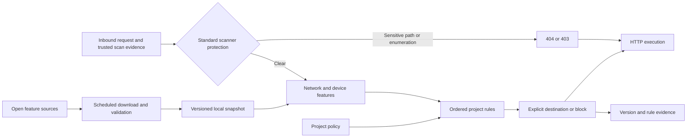

# Radixing TDS

[](https://github.com/imphillip/radixing-traffic-engine/actions/workflows/ci.yml)
[](LICENSE)

A deterministic Traffic Distribution System for paid-traffic ingress and conditional destination routing. Automatically refreshed open IP, network and crawler data enrich incoming requests; explicit project rules select a destination. Run it as a Node.js redirect service or embed its TypeScript decision core.

**Version 1.1.0 uses no Jev, LLM, model providers or API keys.** Identical policy, data snapshot, request observations and evaluation time produce identical decisions. Deterministic matching does not make upstream labels, User-Agent claims or inferred locations infallible.

## Request flow



No dataset download happens on the request path. Refresh failures preserve the last valid snapshot. Expired or unavailable feature sources contribute unknown values; unmatched requests use the configured default.

## Included capabilities

- IPtoASN IPv4 and IPv6 ASN/organization mapping.
- X4B known VPN and datacenter IPv4 prefix lists.
- Automatically refreshed crawler User-Agent rules, matched with a linear-time RE2 engine.
- Browser, OS and device parsing with pinned Bowser; bounded Client Hints consistency checks.
- Optional DB-IP Country Lite geolocation with attribution requirements.
- Project rules for network, geography, device, browser, campaign, path and method; IPv4/IPv6 CIDR conditions.
- Stable weighted A/B assignment using an explicit key, fixed salt and missing-key fallback.
- Redirects with explicit query forwarding and optional path forwarding.
- Default sensitive-path blocking and bounded standalone path-enumeration protection before project routing.
- Checksummed data snapshots, atomic activation, previous-version rollback and source freshness evidence.
- A standalone Node.js service with scheduled refresh and a separately importable synchronous core.

Network and bot labels never block traffic automatically. Sensitive exposure targets return 404; confirmed path-enumeration evidence returns 403. See [scanner protection](docs/scanner-protection.md) for thresholds, explicit overrides, shared-IP limitations and embedded-host responsibilities. Security is supporting functionality, not a managed WAF or DDoS service. Browser Canvas/WebGL fingerprint collection, visitor tracking, conversions, merchant accounts and administration UI are outside this release.

## Run

Requires Node.js 22 or later.

```sh
git clone https://github.com/imphillip/radixing-traffic-engine.git
cd radixing-traffic-engine
git checkout v1.1.0
npm ci
npm run data:sync
npm start -- --policy examples/policy.json --data .tds-data
```

Edit the example policy to use your ingress hostname and HTTPS destinations. The example uses reserved `example.com` domains and is not a live routing configuration. The service binds to `127.0.0.1:8787` by default; use a TLS reverse proxy for public ingress.

```sh
curl -I -H 'Host: go.example.com' http://127.0.0.1:8787/
```

On startup the service loads a verified snapshot, or downloads one if no snapshot exists. It refreshes all configured sources every 24 hours and reloads externally updated or rolled-back snapshots every minute. Sources older than seven days are excluded from enrichment. Change these limits with `--refresh-hours` and `--max-age-hours`.

```sh
# Optional country lookup; read the attribution requirements first.
npm run data:sync -- --country
npm start -- --country

# Restore the previously active dataset; a running service reloads it within a minute.
node dist/cli.js rollback --data .tds-data
```

Country mode must be used consistently for sync and serve. With country mode, the current month's DB-IP URL is resolved on every refresh. Without it, country can be supplied by a trusted host integration.

## Embed

The package is distributed through GitHub and release assets, not the npm registry. Pin a tag or a full commit for production builds.

```sh
npm install git+https://github.com/imphillip/radixing-traffic-engine.git#v1.1.0
```

```ts
import { createTds } from "@radixing/traffic-engine";

const tds = createTds(projectPolicy, downloadedSnapshot);
const { response, decision } = tds.handle({
  request,
  ip: trustedClientIp,
  now: Date.now(),
});
// Return response; persist decision versions and rule IDs in your own audit store.
```

`@radixing/traffic-engine/node` exports the updater, snapshot loader, rollback and standalone server. The core import has no Node.js dependencies and performs no I/O. Full global ASN snapshots can consume substantial memory; constrained edge integrations should use scoped datasets or host-supplied trusted ASN/geolocation observations. The library never trusts forwarded-IP headers by itself.

## Documentation

- [Architecture](docs/architecture.md): data plane, execution and host responsibilities.
- [Open data sources](docs/data-sources.md): formats, licenses, provenance, coverage and update validation.
- [Policy reference](docs/policy-reference.md): fields, matching, stable split and action semantics.
- [Operations](docs/operations.md): automatic refresh, rollback, reverse proxy and deployment.
- [Migration to 1.0](docs/migration-1.0.md): removed model APIs and compatibility boundaries.
- [Scanner protection and 1.1 migration](docs/scanner-protection.md): default guards, bounded state and host contracts.
- [Probe provenance](docs/rule-provenance.md): the narrow built-in sensitive-path catalog.

## Development

```sh
npm ci
npm run check
```

Tests use synthetic fixtures and mocked feeds; normal CI makes no live provider calls. Live source verification is an explicit operator command. Weekly Dependabot proposals maintain pinned parser dependencies; a parser update requires review, tests and a new release. Dataset refreshes do not update parser code or rewrite project rules.

The engine code is MIT licensed. Downloaded datasets and dependencies retain their own terms; see [third-party notices](THIRD_PARTY_NOTICES.md). No private hosting configuration, merchant traffic or credentials are included.
