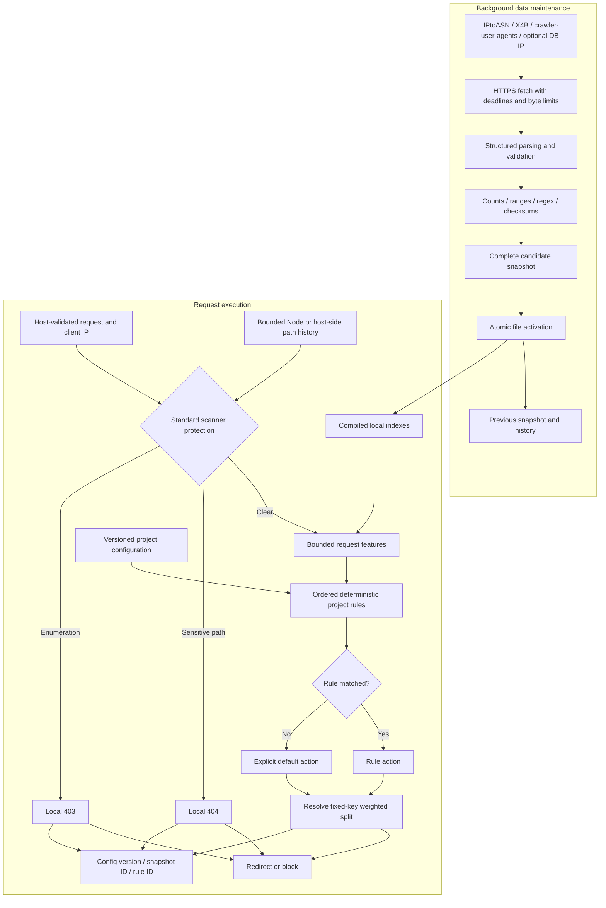

# Architecture

Radixing TDS 1.2 selects HTTP destinations from per-request facts and project configuration. Standard scanner protection precedes project routing. It contains no model gateway, model-generated rules, learning scheduler or general event-stream processor.

The architecture has three independently managed inputs: engine/parser code, versioned feature data, and project policy. Upstream data maintenance refreshes facts; project configuration selects destinations; scanner guards handle a narrow set of exposure and enumeration patterns. Neither a dataset refresh nor a model proposes new rules in the current engine.

## Boundaries

Public data flows into deployment-local files and compiled in-memory indexes. Git contains source adapters and parser dependency declarations, not downloaded production databases. A visitor request queries active local indexes without calling the upstream feeds. [Data lifecycle](data-sources.md#data-lifecycle) describes cold start, refresh failure, age limits and rollback.

The synchronous core validates policies, compiles data, derives request features, evaluates ordered rules and builds a Web `Response`. Inputs include an explicit evaluation time: freshness changes are therefore part of the input rather than hidden clock access. Compiled indexes are captured by the engine and cannot be altered by mutating the caller's original snapshot or policy.

The Node adapter owns downloading, decompression, files, timers, HTTP sockets and bounded process-local scanner history. The core receives enumeration evidence explicitly and has no hidden visitor history. Scanner protection runs before feature parsing and project rules; these blocks require no fresh network dataset. See [scanner protection](scanner-protection.md) for thresholds and tracking limitations.

The adapter keeps one compiled engine active, then swaps references after a complete candidate is validated. Requests already evaluating retain their previous engine. The updater publishes a complete snapshot; one failed source prevents publication. No request waits for a provider API. Dataset swaps preserve the running adapter's scanner state.

The host owns authenticated ingress, client IP trust, tenant isolation, project policy publication, TLS, operational limits, audit storage and retention. The standalone service loads one project policy at startup. Policy changes require a validated restart; data changes reload automatically. It does not provide a multi-tenant merchant control plane. The [deployment responsibility matrix](deployment.md#responsibility-matrix) distinguishes built-in standalone behavior from application-owned embedded behavior.

## Determinism and evidence

Rule priority is ascending and stable; equal priorities preserve configured array order. The first match is terminal. Missing facts cannot satisfy negative rules. Known-list misses mean no match in that dataset, not verified absence of VPNs or automation. IP network registration country is separate from geolocation.

Weighted split is resolved from a named signal, a fixed salt and integer weights, using version 1 UTF-8 FNV-1a assignment. It uses no randomness, cookies or inferred device identity. Missing keys use a required fallback URL. Assignment stability depends on stable input keys and unchanged salt/targets/weights. This hash is not suitable for authentication or secrets.

Decision evidence contains policy version, snapshot ID, matching rule, evaluated conditions, stale sources, matched source IDs and parser version. Protection decisions use `evaluation.source: "protection"`, a built-in rule ID and versioned protection evidence; `parser: null` and an empty rule trace indicate enrichment and project matching were skipped. It omits raw IP addresses, header values and campaign values. Applications can retain authorized request environment data separately, with their own credential exclusion and retention policy.

## Policy and data changes

| Input | Owner and activation | Effect |
| --- | --- | --- |
| Feature data | Node updater or host publisher activates a valid snapshot | Changes observations available to existing rules |
| Project policy | Application/operator publishes validated rules; standalone restarts | Changes priorities, destinations, conditions and A/B assignment |
| Engine and parsers | Maintainer releases code; application upgrades its pin and deploys | Changes matching, parsing or built-in guard behavior |

For example, a newly listed VPN prefix can change routing only when a project rule uses that observation. It does not create a default VPN block. A new probe target requires a code/catalog release rather than the daily data updater. Identical inputs produce identical decisions; refreshing data can intentionally change those inputs.

## Edge integrations

The core consumes Web Requests and JSON snapshots without importing Node APIs. A host can supply trusted `geo.*`, `network.asn` and organization observations. Those explicitly supplied facts override inferred values; URL hostname/path/method and validated client IP remain bound to the actual request.

Global data downloads and filesystem operations belong to the Node adapter or a suitably sized data publisher. For small selected feeds, the [portable Web builder](web-updater.md) shares Node's source adapters but uses Web Crypto and bounded Compression Streams in a host-owned background job. It requires explicit source selection and leaves shard/index acceptance to a host hook, avoiding whole-snapshot lookup compilation. Full datasets are not automatically bundled into constrained worker isolates. Edge hosts can publish scoped snapshots and construct a fresh engine when a snapshot changes. Updating this repository does not upgrade any separately pinned hosted deployment.
