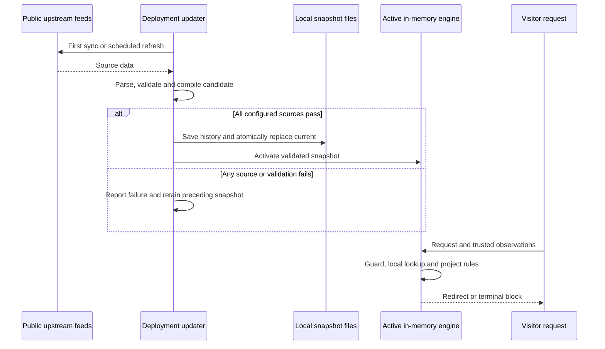

# Open data sources

## Data lifecycle

Remote datasets are downloaded to the deployment environment. They are not checked into this repository, bundled in release packages, or requested upstream for each visitor. The standalone Node updater owns downloads and local files; embedded hosts can use the portable Web builder in their own background job. The synchronous core only consumes a supplied snapshot and trusted request observations. Bowser is a pinned parser dependency rather than a remotely refreshed dataset.

Default standalone timings: refresh every 24 hours, externally changed snapshot reload every 60 seconds, and source maximum age seven days. Startup without a snapshot requires successful sync; startup with corrupt data fails. A failed refresh preserves the preceding valid snapshot but does not reset its source ages. The core omits expired facts, so later requests continue with remaining facts, scanner guards and project rules/defaults.

These schedules belong to the standalone adapter. Embedded hosts own their own data publication and engine activation; see [deployment modes](deployment.md). Built-in upstream requests retrieve public files; they do not send visitor IPs or request environment data to data providers.

## Default source set

| Source | Data | Upstream license | Refresh characteristics |
| --- | --- | --- | --- |
| [IPtoASN](https://iptoasn.com/) | IPv4/IPv6 address ranges, ASN, organization, network country | PDDL 1.0 | Upstream advertises hourly updates; TDS refreshes daily by default |
| [X4B lists_vpn](https://github.com/X4BNet/lists_vpn) | Separate known VPN and datacenter IPv4 prefix lists | MIT, including generated lists | Regular automated upstream rebuilds |
| [crawler-user-agents](https://github.com/monperrus/crawler-user-agents) | Known crawler UA patterns and source URLs | MIT | Latest upstream JSON is fetched on each refresh |
| [Bowser](https://github.com/bowser-js/bowser) | Browser, OS and platform parsing | MIT-labelled license with an additional modified-distribution contact requirement | Exact dependency version; code updates require a tested package release |
| [DB-IP Country Lite](https://db-ip.com/db/download/ip-to-country-lite) | Optional IPv4/IPv6 country geolocation | CC BY 4.0 | Monthly files; reduced coverage/accuracy compared with commercial data |

DB-IP is opt-in with `--country`. Follow its attribution terms, including the stated link-back requirement on web pages displaying or using results. Attribution is the deployer's responsibility; the redirect service does not inject attribution into destination pages. This project does not redistribute downloaded production datasets in Git or release packages.

The researched [ipverse/as-ip-blocks](https://github.com/ipverse/as-ip-blocks) is a CC0 alternative for organization-specific BGP prefix sets. It is not a built-in adapter: IPtoASN provides the initial global mapping, avoiding duplicated ASN resolution. Likewise, uap-core and isbot are alternatives rather than additional overlapping default parsers. This release does not claim to integrate every researched source.

## Import and validation

The Node updater downloads five default feeds, or six with country mode. TSV and CSV use `csv-parse`; JSON uses the standard parser; IP/CIDR syntax uses `ipaddr.js`; crawler patterns compile with RE2JS. Unsupported regex syntax rejects the whole candidate rather than silently executing unsafe backtracking expressions or dropping patterns.

Every Node source download has a 60-second deadline, a 32 MiB received-byte limit and a 128 MiB expanded-data limit. These are configurable through `SyncOptions`. Node validation rejects malformed rows, invalid countries/ASNs/addresses, backwards or overlapping ASN/country ranges, empty or unexpectedly small feeds, and a greater-than-50% record-count reduction against the preceding source version. Prefix lists may overlap and are merged into searchable intervals. Unmapped ASN 0 entries are omitted; IPtoASN `Unknown` country becomes an internal `ZZ` value and does not emit a country signal.

The [Web builder](web-updater.md) shares source definitions, parsers and record checks but defaults to smaller limits and requires explicit source selection. It does not compile whole-snapshot lookup indexes; hosts perform cross-record and shard/index acceptance through `validateSnapshot` before publication. Node continues full index acceptance. Both return the same schema and checksum for identical source bytes and retrieval time.

The complete candidate is normalized before hashing. The snapshot ID is SHA-256 of the canonical `{ sources, data }` JSON. Each source records its ID, public URL, license, fetch time, raw download checksum and accepted record count. Checksums detect local corruption; they do not authenticate an upstream maintainer or prove dataset accuracy. `fetchedAt` records local retrieval time, not the original observation time of every upstream record.

## Coverage and freshness

- `network.vpn` and `network.datacenter`: membership in the selected known lists. These initial feeds cover IPv4 only; IPv6 is unknown.
- `client.bot`: matching a known crawler User-Agent pattern. A miss is not verified human status. A match is not crawler identity verification.
- `network.country`: IPtoASN network-country information, never automatically copied to `geo.country`.
- `geo.country`: optional DB-IP geolocation or an explicitly trusted host observation.
- Browser/device features: bounded UA parsing; visitors can forge headers and some device details are absent from modern UAs.

Freshness is checked at evaluation using the supplied clock and configured maximum age (seven days by default). Future-dated or expired source facts are omitted. Missing data does not become false and does not match `neq`, `notIn` or `notInCidr`. A valid negative known-list result means only that the list had no matching entry. Explicit trusted host observations have their own host-owned freshness contract; the snapshot age limit does not validate them.

| Source condition | Result |
| --- | --- |
| Fresh ASN range matches the supplied IP | Emit numeric ASN, organization and known network country |
| Fresh IPv4 VPN list has no matching entry | Emit `network.vpn: false`, meaning only a known-list miss |
| VPN data is missing/stale, or the client is IPv6 | Leave `network.vpn` unknown |
| Fresh crawler pattern matches User-Agent | Emit `client.bot: true`, without authenticating identity |
| No project rule matches the available observations | Use the configured default, after enabled scanner guards |

Upstream data updates can change feature membership and therefore routing under an unchanged policy. They do not alter rule expressions, targets, priorities or A/B weights. Operators can inspect snapshot manifests and restore an earlier snapshot. Old sources continue to age after rollback; rollback never resets retrieval time.
