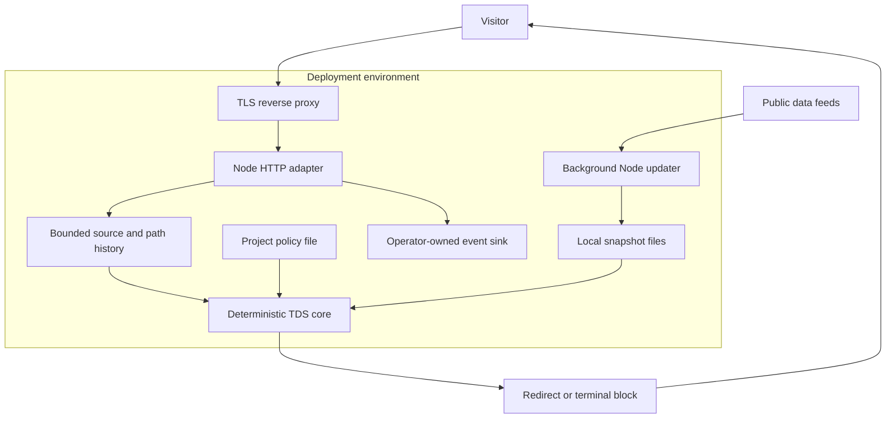
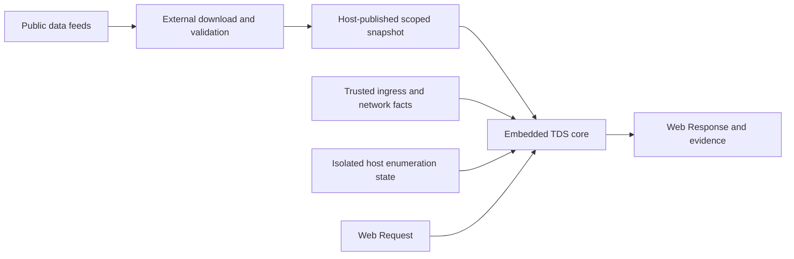

# Deployment modes

The same deterministic decision core can run inside a standalone Node service or an application-owned ingress. Choose where data maintenance and state live before choosing which datasets to load. The public repository contains no managed-service bindings, deployment credentials or customer policies.

## Responsibility matrix

| Responsibility | Standalone Node service | Embedded Node application | Edge or other embedded host |
| --- | --- | --- | --- |
| Execute redirects and blocks | Built-in HTTP listener | Call `createTds().handle` and return its response | Call `createTds().handle` and return its response |
| Fetch remote feature feeds | Node updater, first sync and scheduled refresh | Host calls the separately imported Node updater | External publisher or host data pipeline |
| Store snapshots | Local data directory; persistent volume recommended | Host-selected directory or storage adapter around publication | Host-managed storage and bounded deployment-specific snapshots |
| Compile and swap active data | Built in after validation | Host constructs and activates a new engine | Host constructs and activates a new engine |
| Identify client IP | Socket peer or explicitly trusted proxy header | Host validates ingress identity | Host validates platform-provided identity |
| Block sensitive paths | Enabled by default | Enabled by default through `createTds` | Enabled by default through `createTds` |
| Detect path enumeration | Bounded process-local tracker | Host state or exported Node tracker | Host-owned isolated and serialized state |
| Publish project policy | Validated startup configuration; restart to change | Host owns configuration lifecycle | Host owns configuration lifecycle |
| TLS, accounts, UI, tenant isolation and retention | Operator/application | Host application | Host application |

Low-level `evaluateRules`/`explainRules` only evaluate supplied policy and signals. They do not install the TDS request guard, data maintenance or HTTP execution workflow.

## Standalone layout



The proxy must preserve the configured Host header. A proxy client-IP header is trusted only when its exact socket peer is configured and the proxy overwrites the header with one actual IP. Otherwise all users can appear as the proxy itself, causing shared network features and enumeration counts. See [client IP trust](operations.md#client-ip-trust).

The default data directory is `.tds-data/`, ignored by Git. Its contents are:

```text
.tds-data/
  current.json             # Active complete snapshot
  previous.json            # Previous complete snapshot, after a replacement
  snapshots/
    <snapshot-id>.json     # Validated snapshot history
  .sync-lock/              # Present while a sync or rollback owns the directory
```

Store this directory on persistent storage if data should survive container replacement. Snapshot history is retained until the operator prunes it; it is not an unlimited free archive. One updater owns a directory at a time. Scanner history is separate, in memory only, and is neither saved here nor shared across service replicas.

Use the commands in [operations](operations.md) to sync, serve, roll back and configure refresh intervals. Startup without a snapshot waits for a successful download. A corrupt existing snapshot fails startup; a corrupt reload leaves the active engine intact. A running engine needs no upstream connection to handle visitors.

## Embedded Node

Load data once when constructing the engine, rather than loading or compiling on every visitor request:

```ts
import { createTds } from "@radixing/traffic-engine";
import { loadFeatureSnapshot } from "@radixing/traffic-engine/node";

const snapshot = await loadFeatureSnapshot("/var/lib/tds/current.json");
let activeTds = createTds(projectPolicy, snapshot);

function handleIngress(request: Request, trustedClientIp: string, now: number) {
  return activeTds.handle({ request, ip: trustedClientIp, now });
}

async function activatePublishedData() {
  const candidate = await loadFeatureSnapshot("/var/lib/tds/current.json");
  const next = createTds(projectPolicy, candidate);
  activeTds = next;
}
```

The application owns the refresh/reload schedule and should preserve the preceding engine if validation or compilation fails. Import `syncFeatureData` from the Node entry point if the application itself owns upstream downloads. `createTds` performs no filesystem or network I/O. Add enumeration through the [embedded host contract](scanner-protection.md#embedded-host-contract); the example above deliberately provides no history evidence.

## Edge integrations



Keep Node APIs, filesystem operations, decompression and global feed downloads outside the constrained request runtime. Full global data is substantial: one initial smoke observed about 1.16 GiB peak RSS and 3.8 seconds to compile, not a deployment capacity guarantee. Measure both steady-state memory and update headroom.

Use a scoped snapshot with appropriate source metadata, trusted host-provided network/geolocation facts, or a combination. A trusted fact does not require a local copy of the equivalent global dataset. All snapshot data collections must still be present as arrays, even when intentionally empty. A `FeatureSnapshot` contains `schemaVersion`, `id`, `sources` and `data`; consult the [public types](../src/features.ts). `parseFeatureSnapshot` validates structure; a custom publisher must separately verify authenticity and integrity because the core does not recompute the Node publisher's checksum.

The host owns publication, isolation, state serialization and atomic engine replacement. The public package does not provision an edge scheduler or storage resources, and the standalone refresh defaults do not automatically apply to an embedded runtime.

## Independent updates

| Change | What activates it |
| --- | --- |
| Upstream IP/network/crawler data | Successful data refresh and active snapshot replacement |
| Project routing rules or destinations | Reviewed policy publication; standalone restart |
| Parser code, probe catalog or engine behavior | Tested package upgrade and application deployment |

Dataset refresh can change feature membership under an unchanged rule. It cannot rewrite priorities, destinations, split weights or the built-in probe catalog. Publishing a public engine version does not upgrade a separately pinned hosted application. Follow [migration to 1.0](migration-1.0.md) and [1.1 scanner migration](scanner-protection.md#evidence-and-upgrading-from-10) when adopting from an older release.
