# Temporal traffic analysis

Version 0.4 adds a pure, bounded event-window contract beside the existing request-time rule evaluator. The purpose is to discover changes in ingress traffic over time and test whether a proposed rule adds value beyond the published static policy. It does not classify a visitor's intent, call a model, persist events, or change a live route.

```mermaid
flowchart LR
    A["Host validates and scopes ingress observations"] --> B["Static policy decision"]
    A --> C["Versioned event stream"]
    C --> D["Bounded per-stream state"]
    D --> E["Current and previous window evidence"]
    E --> F["Optional candidate discovery: statistics, analyst, or model"]
    F --> G["Chronological replay on a later period"]
    G --> H["Independent outcome and cost review"]
    H --> I["Host-controlled policy publication"]
    I --> B
    B --> J["Host executes selected action"]
```



The immediate request path can use only a previously validated, published policy and evidence available at decision time. Window analysis, candidate generation, review and publication can run asynchronously. The old `decideWithJev` path remains an optional, separate request-time integration; this package does not disable or migrate a host's existing model policy.

## Event and state contract

`TemporalEvent` version 1 contains a positive host `featureVersion`, `propertyId`, `streamId`, `eventId`, millisecond `at`, `pathKey`, optional `fingerprintKey`, and a `probe` boolean. All keys are bounded opaque tokens. The host derives them from trusted ingress data and must not pass raw IP addresses, URLs, queries, credentials, or personal data as keys. For example, a host may use a property-scoped HMAC token for a source, a normalized path category token, and a versioned fingerprint digest. The engine neither defines the grouping strategy nor claims that one token identifies a person.

`advanceTemporalWindow(previous, event, options)` accepts chronological events for exactly one property and stream. The state binds `featureVersion`, `windowMs`, `maxEvents`, and `minSamples`; changing any binding requires a new stream state or replay. The API rejects mismatched properties or feature versions, timestamps going backward, duplicate IDs still retained in state, and malformed keys. The host remains responsible for durable idempotency beyond the retained horizon, cross-worker ordering, tenant isolation, state expiry, and persistence. Use one serialized writer or an equivalent atomic state update per stream.

The current window is `(event.at - windowMs, event.at]`; the previous window is `(event.at - 2 * windowMs, event.at - windowMs]`. State retains at most `maxEvents` from the two-window horizon. It reports incomplete history until the stream has covered both windows; if the cap evicts an event that still belongs to that horizon, it withholds change signals until the affected period has passed. The allowed bounds are one minute to one day, 20 to 2048 retained events, and a minimum of 5 samples per window (at most half the event cap). These are correctness bounds, not a production sizing recommendation.

Each window reports request count, distinct path count, repeat share, probe share, path-transition share, fingerprint coverage/dominant share, and the largest fixed UTC-minute bucket. `TemporalEvidence` version 1 reports the windows and, when both are complete and sampled, changes between them. `temporalSignals(evidence)` returns no fields when evidence is incomplete or sparse. Fingerprint concentration change is omitted unless *every* event in both windows has a fingerprint key. Ratios and deltas are descriptive, not significance tests; adjacent sliding comparisons are correlated.

```ts
import { advanceTemporalWindow, temporalSignals } from "@radixing/traffic-engine";

const options = { windowMs: 15 * 60_000, maxEvents: 512, minSamples: 20 };
const { state, evidence } = advanceTemporalWindow(previousState, {
  version: 1,
  featureVersion: 1,
  propertyId: "example",
  streamId: "source_group_a",
  eventId: "request_42",
  at: Date.now(),
  pathKey: "login_path",
  fingerprintKey: "fingerprint_digest_a",
  probe: false,
}, options);
const signals = temporalSignals(evidence);
// Persist state atomically; use signals only if evidence.ready and the host's policy permits it.
```

Hosts should validate feature coverage, token stability, clock skew and queue arrival delays before considering these values for request-time decisions. A delayed event must be handled through a separate ordered replay or window correction, not inserted into a later live state. Missing evidence must remain unknown; a sparse cohort is not proof of benign behavior. The event contract intentionally excludes the selected action, so the current request's outcome cannot leak into its own decision features.

## Forward replay and evaluation

`replayTemporalProposal(config, proposal, cases, validationStartAt, options)` walks events in nondecreasing time order. Earlier cases warm each stream's state; only cases after `validationStartAt` with complete evidence are scored. The validation boundary must be later than the proposal's `createdAt`. The function rejects precomputed `temporal.*` signals, preventing callers from supplying features calculated with future events. It reuses `replayRuleProposal` to compare the candidate's *selected action* with the current first-match policy. The summary discloses context events and validation events skipped for incomplete evidence, changed actions, newly blocked independently reviewed unwanted visits, and newly blocked independently reviewed legitimate visits.

```ts
const summary = replayTemporalProposal(config, proposal, chronologicalCases,
  validationStartAt, options);
```

Only independently reviewed `manual` or `external_outcome` labels belong in `reviewedOutcome`. A Jev or other model label is a discovery hint, not a truth label. Neither a model's confidence nor the number of classified requests proves incremental detection, false-positive safety, conversion benefit, or return on spend. Review later held-out periods and compare changed actions with static-only decisions. Include representative false positives, actual execution outcomes, latency, provider spend, storage/compute cost, and any measured business outcome separately. Do not use the same events to choose thresholds and claim an unbiased validation result. A second later period or controlled rollout is needed before promotion.

The replay input is capped at 20,000 events and 1,000 streams per call; larger corpora should be partitioned by the host without losing per-stream warmup. The summary does not include raw inputs. A candidate with no independently reviewed outcomes can be replayed, but its quality remains unknown.

## Optional candidate providers

`TemporalCandidateProvider` is an optional host-implemented interface that accepts versioned evidence and an abort signal and returns an untrusted proposal. It specifies no Jev, LLM, LSTM, or Transformer dependency. Any returned value still passes `parseRuleProposal`, chronological replay, independent review, and host-controlled publication. The engine does not schedule daily or incident jobs or run a model itself.

## Host integration boundary

| Engine | Host application |
| --- | --- |
| Versioned event/window types and bounded pure state advance | Trusted collection, property-scoped tokens, input normalization, tenant isolation and durable ordering |
| Descriptive changes and rule-input mapping | Window orchestration, state storage/expiry, delayed-event handling and coverage monitoring |
| First-match evaluation and chronological candidate replay | Reviewed labels, outcome joins, cost accounting, candidate discovery and approval |
| Optional provider type | Provider selection, secrets, quotas, timeouts, circuit breakers and invocation schedule |
| No side effects | Policy publication, rollback, actual action execution and production verification |

A host must explicitly adopt a new engine commit, align the event/schema versions, test extraction and replay on its own data, and release its integration separately. The public package update alone cannot change live Jev behavior or merchant routing.
