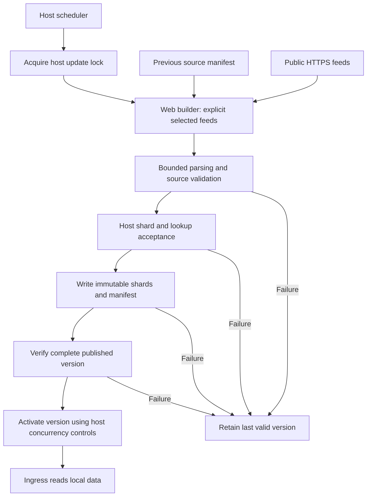

# Portable Web updater

Version 1.2 adds `@radixing/traffic-engine/web` for deployment-local background refresh in Workers and other Web API runtimes. It does not provision a scheduled job or change the synchronous request path. There are no imports of Node filesystem, HTTP server, child process, crypto or zlib modules; the CSV parser uses its browser distribution, including its internal byte utilities, without requiring a global `Buffer` or `process`.

## API

```ts
import {
  buildFeatureSnapshot,
  defaultSources,
  computeFeatureSnapshotId,
  type FeatureSnapshot,
} from "@radixing/traffic-engine/web";

async function prepareCandidate(
  previous: Pick<FeatureSnapshot, "sources"> | undefined,
  validateShards: (snapshot: FeatureSnapshot) => Promise<void>,
) {
  return buildFeatureSnapshot({
    sources: defaultSources.filter((source) =>
      ["vpn", "datacenter", "crawlers"].includes(source.id)),
    maxDownloadBytes: 4 * 1024 * 1024,
    maxExpandedBytes: 8 * 1024 * 1024,
    maxRecordsPerSource: 100_000,
    maxSnapshotBytes: 16 * 1024 * 1024,
    timeoutMs: 60_000,
    validateSnapshot: validateShards,
  }, previous);
}

// The host calls prepareCandidate in its scheduled/background handler,
// awaits it, writes immutable validated shards, then activates their version.
// computeFeatureSnapshotId(candidate) verifies the same schema-1 payload ID.
```

Exports include `buildFeatureSnapshot`, `computeFeatureSnapshotId`, `defaultSources`, `countrySource`, and `SourceDefinition`, `SyncOptions`, `WebSyncOptions`, `FeatureSnapshot`, `FeatureSource` types. Web `sources` is mandatory and must be non-empty and unique. Selecting only the three feeds above never downloads ASN or country data. URLs and minimum record counts are shared with the Node updater. Custom sources must use the corresponding format and credential-free HTTPS; Fetch uses `redirect: "manual"` for Workers compatibility and rejects every non-2xx response, including redirects, without following its Location.

`buildFeatureSnapshot(options, previous?)` returns a `Promise<FeatureSnapshot>`. The optional previous argument needs only `sources`, allowing a host to read the preceding manifest instead of reassembling all old shards. Its per-source counts enforce the same default 50% maximum drop. Retrieval timestamps, raw SHA-256 checksums, source IDs, URLs, licenses and accepted counts retain the 1.1 schema. Given identical inputs and retrieval time, normalized data and snapshot IDs match the Node builder. The ID hashes the UTF-8 JSON of `{ sources, data }`, in that key order. It includes retrieval timestamps, so another day's retrieval has a different ID even if feed contents are identical.

## Limits and validation

| Option | Web default | Node default |
| --- | --- | --- |
| `timeoutMs` | 60 seconds per source download, including body reads | Same |
| `maxDownloadBytes` | 4 MiB per response body | 32 MiB |
| `maxExpandedBytes` | 8 MiB per expanded source | 128 MiB |
| `maxRecordsPerSource` | 100,000 accepted records | 3,000,000 |
| `maxSnapshotBytes` | 16 MiB of canonical `{ sources, data }` UTF-8 JSON | 256 MiB |
| `maxDropFraction` | 0.5 | Same |

Limits must be positive safe integers; timeout is at most 2,147,483,647 milliseconds. Drop fraction is finite and between 0 and 1. Invalid configuration fails before fetching. Downloads run sequentially. Body and decompression streams are read with byte bounds and cancelled on failure. UTF-8 decoding is strict. HTTP failures, timeouts, invalid CIDRs/ranges, malformed JSON/CSV/TSV, unsupported individual RE2 patterns, undersized feeds and suspicious count drops reject the candidate. Source-format and schema collection limits still apply independently of configured limits.

The builder buffers bounded source bytes and the complete selected candidate; it is not a constant-memory streaming publisher. JSON parsing, schema normalization, hashing and a host hook can allocate additional copies. Byte limits are acceptance bounds, not a process heap or CPU guarantee. Hosts must measure update headroom and retain appropriate runtime limits. Global ASN/country feeds remain unsuitable for a small Worker; use trusted platform facts or a separate large-data pipeline.

The Web builder validates individual records and crawler expressions, but deliberately does **not** call `compileFeatureSnapshot`: no whole-candidate BigInt interval indexes or composite crawler matcher are constructed. Cross-record range overlap and composite matcher/index acceptance belong to the host's lookup strategy. Before publication, use `validateSnapshot` to compile/check every shard with the same code used by readers, including cross-shard invariants where relevant. The hook may be asynchronous, runs before the candidate is returned, and rejects the entire build on error. It must not mutate the snapshot; mutation is rejected by a checksum check. Absence of a hook means structural/per-record acceptance only, not readiness for a particular lookup runtime.

The Node builder always performs full `compileFeatureSnapshot` acceptance after the shared build. Its existing defaults, file layout, locks, server and rollback API remain available. Node callers can opt into the additional record/size bounds and validation hook. Existing on-disk 1.1 snapshots load unchanged.

## Host publication responsibilities



The host owns schedule, retries, mutual exclusion, storage bindings, shard sizing, immutable version publication, active-version switching, retention and rollback. Returning a candidate does not activate it. Store all shards and their manifest before exposing the version; account for the storage system's consistency model rather than claiming a globally atomic switch. Failed refreshes preserve still-valid old data, without resetting source ages. Expired facts remain unknown. Project rules, destinations and scanner guards are unchanged by this release.

Run builder I/O inside a request/scheduled execution context and await it or attach the complete job to the host's execution lifetime. Do not run downloads at module initialization or on every visitor request. Cloudflare documents [Web Crypto](https://developers.cloudflare.com/workers/runtime-apis/web-crypto/), [Compression Streams](https://developers.cloudflare.com/workers/runtime-apis/web-standards/#compression-streams) and [runtime limits](https://developers.cloudflare.com/workers/platform/limits/); the public package supplies no Cloudflare account IDs, bindings, routes or credentials.

## Verification and adoption

Normal CI uses synthetic feeds, including gzip fixtures. Tests compare Node/Web output and the 1.1 hashing algorithm, exercise resource limits and failure paths, and run the browser bundle inside workerd through Miniflare with Node compatibility explicitly disabled (`no_nodejs_compat` and `no_nodejs_compat_v2`). Browser bundling rejects Node built-in dependencies; runtime assertions also confirm global `process` and `Buffer` are absent. This is API/runtime acceptance, not proof of a deployed scheduler, storage consistency or an actual daily refresh.

Pin `v1.2.0` or its full release commit, import the Web entry only in the updater, validate real selected-source headroom and shard lookups, then test publication/failure retention before retiring the preceding schedule. Ingress consumers can keep schema-1 data; no customer policy migration is needed. See [deployment modes](deployment.md), [source provenance](data-sources.md) and [release notes](releases/1.2.0.md).
